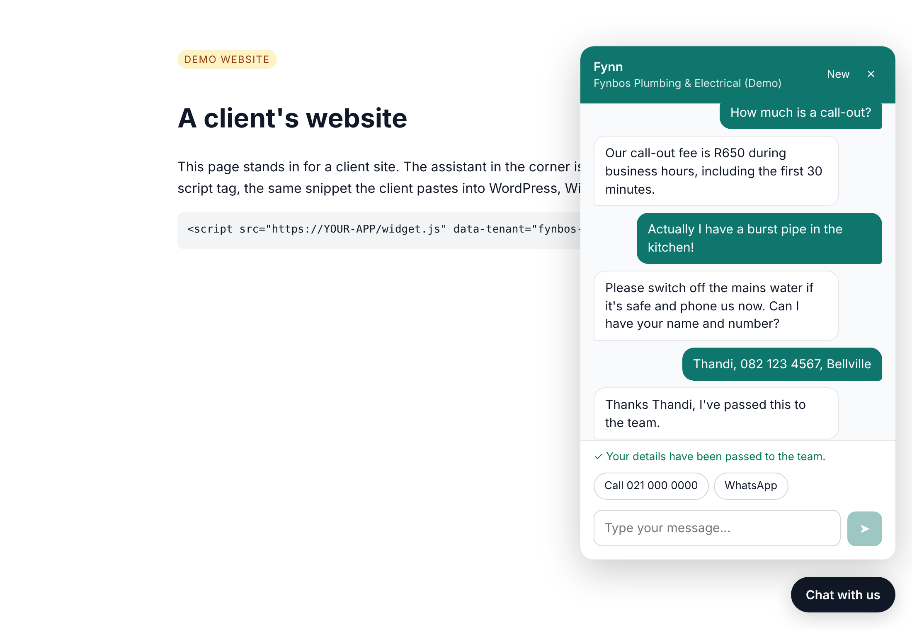

# Intelligent Enquiry System

A multi-tenant AI enquiry assistant for small businesses. A client gets it on their website by
adding one script tag. The assistant answers questions **only** from that business's approved
information, qualifies the enquiry, captures contact details, and hands over to a person (with the
right priority) when it can't help.

Stack: Next.js 16 · TypeScript · OpenAI Responses API (Structured Outputs) · Supabase (Postgres + RLS) · n8n



- **[docs/ARCHITECTURE.md](docs/ARCHITECTURE.md)**: decisions, request flow, data model, security, POPIA. Start here.
- **[docs/N8N-WORKFLOWS.md](docs/N8N-WORKFLOWS.md)**: the webhook contract and the workflows to build.
- **[docs/BUILD-PLAN.md](docs/BUILD-PLAN.md)**: the 14-day plan from here to a first client, plus packaging.

> This folder lives inside the Barber Club repo for now and is excluded from that site's build.
> It is self-contained and is meant to move into its own repository (see BUILD-PLAN, last item).

---

## Run it locally

Requires Node 22.18+, a Supabase project and an OpenAI API key.

```bash
cd enquiry-system
npm install
cp .env.example .env.local      # fill in the values
```

Database: run `supabase/migrations/20261118000000_init.sql` and then `supabase/seed.sql` in the
Supabase SQL editor, or with the CLI:

```bash
npx supabase link --project-ref <ref>
npx supabase db push
```

```bash
npm run dev                      # http://localhost:3100
```

Open **http://localhost:3100/demo/fynbos-plumbing-demo**, a fake client website with the widget
embedded. Things to try:

- "How much is a call-out?" → answers R650 and cites the knowledge base
- "What does a geyser replacement cost?" → declines to guess and offers handover (the price isn't in the KB)
- "I have a burst pipe!" → urgent, safety advice, asks for a number
- Leave a name and number → a lead in `leads`, an event in `outbox`, and an email if n8n is wired up

Leads, transcripts and token usage are in the Supabase table editor (`leads`, `messages`).

## Checks

```bash
npm test            # unit tests: guardrails, contact verification, opening hours
npm run typecheck
npm run lint
npm run build
```

## Embed on a client site

```html
<script src="https://YOUR-APP-DOMAIN/widget.js" data-tenant="client-slug" data-color="#0f766e" async></script>
```

The client's domain must be listed in `tenants.allowed_origins`, or the browser will refuse to show
the widget.

## Add a client (v1: SQL)

1. `insert into tenants (slug, name, industry, allowed_origins, config) values (…)`. Use the shape
   in `seed.sql`. It is validated by `src/lib/tenants/schema.ts`, and an invalid config keeps that
   tenant offline.
2. Insert their `knowledge_entries`: services with prices, FAQs, policies and areas. **If it isn't
   here, the assistant won't say it.**
3. Give them the embed snippet.

## Environment

See `.env.example`. Every value is server-only. `OPENAI_MODEL` can be changed without a code
change.
